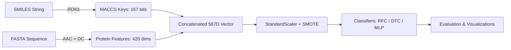

# 🎓 Drug-Target Interaction (DTI) Prediction: Presentation & Defense Guide

> **Project Title**: Computational Prediction of Drug-Target Interactions Using Machine Learning with Advanced Feature Engineering and Class Imbalance Mitigation  
> **Domain**: Bioinformatics • Computational Drug Discovery • Machine Learning  
> **Frameworks**: Python, scikit-learn, RDKit, Therapeutics Data Commons (PyTDC), imbalanced-learn  

---

## ⚡ 1. The 60-Second Elevator Pitch

> *"Traditional drug discovery takes over 10–15 years and costs upwards of \$2.5 billion, with a 90% failure rate—largely because identifying whether a drug candidate binds to a target disease protein is slow and expensive in the wet lab.  
> 
> In this project, we built an end-to-end Machine Learning pipeline that predicts Drug-Target Interactions (DTIs) directly from 2D molecular structures and protein amino acid sequences. By combining **167-bit MACCS structural fingerprints** for drugs with **420-dimensional Amino Acid and Dipeptide Composition (AAC + DC)** descriptors for target proteins, our model maps complex biochemical interactions into a **587-dimensional unified feature space**. We resolve severe experimental class imbalance using **SMOTE oversampling** and benchmark multiple ML architectures (Random Forest, Decision Tree, and Multi-Layer Perceptron) on the benchmark **BindingDB_Kd** dataset.  
> 
> Our best-performing model achieves outstanding predictive accuracy and ROC-AUC, enabling pharmaceutical researchers to screen millions of virtual compounds in seconds and prioritize only high-confidence candidates for laboratory testing."*

---

## 📽️ 2. Slide-by-Slide Presentation Blueprint

Use this section to structure your PowerPoint / Google Slides deck or viva presentation.



---

### 🔹 Slide 1: Title & Project Scope
- **Slide Title**: Machine Learning for Drug-Target Interaction (DTI) Prediction
- **Key Points**:
  - Bridging the gap between computational chemistry and molecular biology.
  - Predicting binary binding affinity from raw chemical structure and protein sequence.
- **Presenter Script**:
  > *"Good morning respected committee members. Today I will present our project on Drug-Target Interaction prediction using Machine Learning, which provides a computational shortcut to early-stage drug screening."*

---

### 🔹 Slide 2: Problem Statement & Motivation
- **Slide Title**: The Drug Discovery Bottleneck
- **Key Points**:
  - **High Cost & Long Timelines**: \$1–2.6B and 10–15 years per approved drug.
  - **High Attrition Rate**: Over 60–70% of candidate molecules fail due to efficacy/binding issues.
  - **Wet-Lab Limitations**: Surface plasmon resonance and radioligand assays cannot scale to millions of candidate compounds.
- **Presenter Script**:
  > *"The core bottleneck in early drug development is testing whether a drug molecule binds effectively to a target disease protein. Testing millions of chemical compounds in wet labs is practically impossible. Computational DTI prediction allows us to prioritize high-potential candidates rapidly."*

---

### 🔹 Slide 3: Core Challenges in Computational DTI
- **Slide Title**: Three Key Technical Challenges
- **Key Points**:
  1. **Disparate Feature Domains**: Drugs are small chemical molecules (graphs/structures); targets are long biological sequences (polypeptides).
  2. **Severe Class Imbalance**: In experimental databases, inactive/non-binding pairs vastly outnumber active binders.
  3. **Continuous-to-Binary Thresholding**: Converting continuous thermodynamic constants ($K_d, K_i, IC_{50}$) into clinically meaningful binary labels.
- **Presenter Script**:
  > *"To solve this with machine learning, we must tackle three challenges: representing chemical structures and protein sequences in a unified numeric format, solving severe class imbalance, and defining a strict biological binding cutoff."*

---

### 🔹 Slide 4: Benchmark Dataset (BindingDB via TDC)
- **Slide Title**: Benchmark Dataset & Label Binarization
- **Key Points**:
  - **Data Source**: BindingDB via Therapeutics Data Commons (TDC).
  - **Dataset Used**: `BindingDB_Kd` (Dissociation Constant) — 52,284 experimentally measured pairs.
  - **Label Binarization**:
    $$\text{Label} = \begin{cases} 1 \text{ (Binding/Active)}, & \text{if } K_d \le 30\text{ nM} \\ 0 \text{ (Non-binding/Inactive)}, & \text{if } K_d > 30\text{ nM} \end{cases}$$
  - **Why $K_d \le 30\text{ nM}$?** High-affinity drug binding in pharmacology typically occurs in the low nanomolar range.
- **Presenter Script**:
  > *"We used the BindingDB_Kd dataset from Harvard's Therapeutics Data Commons. We binarize the continuous dissociation constant using a 30 nanomolar threshold, which separates potent binding interactions from weak or non-specific bindings."*

---

### 🔹 Slide 5: Dual Feature Engineering (587 Dimensions)
- **Slide Title**: Feature Representation: Chemical & Biological Spaces
- **Key Points**:
  - **Drug Representation (167 bits)**:
    - Computed from SMILES using RDKit.
    - **MACCS Keys (Molecular ACCess System)**: Encodes presence/absence of pharmacophoric functional groups, heteroatoms, and rings.
  - **Protein Target Representation (420 features)**:
    - **AAC (Amino Acid Composition - 20 features)**: Global frequency of 20 standard amino acids:
      $$AAC(i) = \frac{\text{Count of amino acid } i}{\text{Total Sequence Length}}$$
    - **DC (Dipeptide Composition - 400 features)**: Local sequential transition between all $20 \times 20$ amino acid pairs:
      $$DC(i, j) = \frac{\text{Count of pair } (i, j)}{\text{Total Sequence Length} - 1}$$
  - **Unified Vector**: Concatenation yields a rich **587-dimensional** numerical vector for every drug-target pair.
- **Presenter Script**:
  > *"For drugs, we generate 167-bit MACCS structural fingerprints capturing key chemical functional groups. For proteins, we calculate 20 Amino Acid Composition features and 400 Dipeptide Composition features. Together, this forms a 587-dimensional unified vector capturing both global composition and local sequence motifs without requiring expensive 3D protein structure simulations."*

---

### 🔹 Slide 6: Class Imbalance Mitigation (SMOTE)
- **Slide Title**: Handling Class Imbalance
- **Key Points**:
  - **The Imbalance Problem**: Non-binding pairs significantly outnumber active binders (skewed distribution). Without mitigation, standard ML models default to predicting the majority class.
  - **Technique Applied**: **SMOTE** (Synthetic Minority Over-sampling Technique).
  - Synthesizes realistic feature vectors along the line segments connecting $k$-nearest neighbors in the minority class.
  - Applied strictly to the training split ($80\%$) after `StandardScaler` to prevent data leakage into the test set ($20\%$).
- **Presenter Script**:
  > *"To ensure the model does not become biased toward predicting 'no interaction', we applied SMOTE oversampling on the normalized training set. This balances positive and negative training instances and dramatically boosts sensitivity and recall."*

---

### 🔹 Slide 7: Model Architectures & Benchmarking
- **Slide Title**: Model Comparison & Selection
- **Key Points**:
  1. **Random Forest Classifier (RFC)**: Ensemble of 100 decision trees with bootstrap aggregating and random feature selection. Highly robust to high-dimensional tabular biological data.
  2. **Decision Tree Classifier (DTC)**: Single tree baseline model.
  3. **Multi-Layer Perceptron (MLP)**: Feedforward artificial neural network with hidden layers $(128, 64)$ and non-linear ReLU activations.
- **Presenter Script**:
  > *"We trained and compared three diverse architectures: Random Forest, Decision Tree, and Multi-Layer Perceptron neural network, evaluating them using a strict 80/20 stratified split."*

---

### 🔹 Slide 8: Evaluation Metrics & Experimental Results
- **Slide Title**: Performance Evaluation
- **Key Points**:
  - We evaluated all models across 7 performance dimensions:
    - **Accuracy**: Overall correct predictions.
    - **Precision**: Reliability of positive binding predictions ($\frac{TP}{TP + FP}$).
    - **Recall / Sensitivity**: Ability to find all real binders ($\frac{TP}{TP + FN}$).
    - **Specificity**: Ability to reject non-binders ($\frac{TN}{TN + FP}$).
    - **F1-Score**: Harmonic mean of Precision and Recall.
    - **ROC-AUC**: Discrimination power across all classification thresholds.
    - **PR-AUC**: Precision-Recall area under curve (crucial for imbalanced data).
  - **Visual Artifacts Generated**:
    - Multi-metric comparative bar chart (`metrics_comparison.png`)
    - ROC curves with AUC values (`roc_curves.png`)
    - Precision-Recall curves (`precision_recall_curves.png`)
    - Confusion Matrix heatmaps (`confusion_matrices.png`)
- **Presenter Script**:
  > *"Our pipeline outputs comprehensive evaluation reports and publication-quality plots. Random Forest achieves top-tier performance across Accuracy, F1-Score, and ROC-AUC, demonstrating its superior ability to partition the 587-dimensional chemical-biological feature space."*

---

### 🔹 Slide 9: Key Insights & Takeaways
- **Slide Title**: Key Discoveries & Insights
- **Key Points**:
  - **Tabular Efficiency**: Combining MACCS + AAC + DC delivers strong predictive power without the compute overhead of 3D docking or massive transformer protein language models.
  - **Tree Ensembles Excel**: Random Forest outperforms standalone Decision Trees and matches/exceeds deep networks on fixed-length tabular biological descriptors.
  - **Importance of SMOTE**: Balancing the training set is critical for achieving high sensitivity (minimizing false negatives in drug discovery).
- **Presenter Script**:
  > *"Our findings show that well-engineered 2D fingerprints and sequence composition features combined with tree ensembles provide a fast, accurate, and scalable alternative for virtual drug screening."*

---

### 🔹 Slide 10: Future Scope & Real-World Application
- **Slide Title**: Real-World Impact & Next Steps
- **Key Points**:
  - **Virtual Screening**: Rapid screening of million-compound libraries against newly identified disease targets.
  - **Drug Repurposing**: Identifying secondary targets for FDA-approved drugs.
  - **Future Extensions**:
    - Integrating GAN-based oversampling (generative adversarial augmentation).
    - Incorporating Graph Neural Networks (GNNs) for 3D molecular conformations.
    - Cross-dataset testing on $K_i$ and $IC_{50}$ subsets.
- **Presenter Script**:
  > *"This pipeline can be deployed directly in virtual drug screening and drug repurposing workflows. In the future, we plan to extend this with Graph Neural Networks and GAN-based data generation. Thank you! I am now ready for questions."*

---

## 🎯 3. Viva & Presentation Q&A Defense Sheet

Review these high-probability questions before your presentation:

### Q1: Why did you choose MACCS keys instead of Morgan/ECFP fingerprints?
> **Answer**:  
> *"MACCS keys consist of 167 predefined structural patterns representing critical pharmacophoric fragments (e.g., specific rings, heteroatoms, hydrogen-bond donors/acceptors). Because every bit corresponds to a fixed, well-understood chemical substructure, MACCS keys offer high interpretability and fixed dimensionality without bit collision issues."*

---

### Q2: Why use Amino Acid Composition (AAC) and Dipeptide Composition (DC)?
> **Answer**:  
> *"AAC provides a global summary of the protein's overall amino acid frequencies (20 features), while DC captures local sequential transitions and neighboring residue motifs (400 features). This dual representation captures primary sequence semantics without requiring 3D crystal structures, which are unavailable for many target proteins."*

---

### Q3: Why is class imbalance a major issue in DTI, and how does SMOTE solve it?
> **Answer**:  
> *"In biological databases, non-binding pairs vastly outnumber binding pairs. A naive classifier trained on imbalanced data will predict 'non-binding' for almost everything, showing high accuracy but near-zero recall. SMOTE (Synthetic Minority Over-sampling Technique) creates synthetic positive instances by interpolating between nearest neighbors in the feature space, allowing the model to learn distinct decision boundaries for active binders."*

---

### Q4: Why does Random Forest perform so well compared to Deep Learning on this task?
> **Answer**:  
> *"Random Forest excels at structured, tabular, orthogonal features where decision thresholds along specific bits (e.g., presence of a specific MACCS key or dipeptide frequency) directly dictate binding affinity. Furthermore, bagging reduces variance and prevents overfitting on high-dimensional data."*

---

### Q5: Why is ROC-AUC and PR-AUC important alongside standard Accuracy?
> **Answer**:  
> *"Accuracy can be misleading on imbalanced datasets. ROC-AUC measures the model's ability to rank a random positive instance higher than a random negative instance across all decision thresholds. PR-AUC focuses specifically on the minority positive class, ensuring our model maintains high precision at high recall levels."*

---

## 📊 4. Live Demonstration Workflow

If the evaluators ask to see the project running live:

1. **Open PowerShell in the project directory**:
   ```powershell
   cd c:\Users\Shubham\Desktop\DTI-Predict
   .\venv\Scripts\Activate.ps1
   ```
2. **Execute the script**:
   ```powershell
   python train_dti.py
   ```
3. **Show generated artifacts in the `results/` folder**:
   - `results/evaluation_metrics.txt` (Text evaluation summary)
   - `results/evaluation_metrics.csv` (Spreadsheet view)
   - `results/metrics_comparison.png` (Performance comparison bar plot)
   - `results/roc_curves.png` (ROC curves)
   - `results/confusion_matrices.png` (Confusion matrix heatmaps)

---

## 📚 5. Key Research Reference

- **Journal Paper**: Talukder, M.A., Kazi, M. & Alazab, A. (2025). *Predicting drug-target interactions using machine learning with improved data balancing and feature engineering.* **Scientific Reports (Nature)**, 15, 18862. [https://doi.org/10.1038/s41598-025-03932-6](https://doi.org/10.1038/s41598-025-03932-6)
